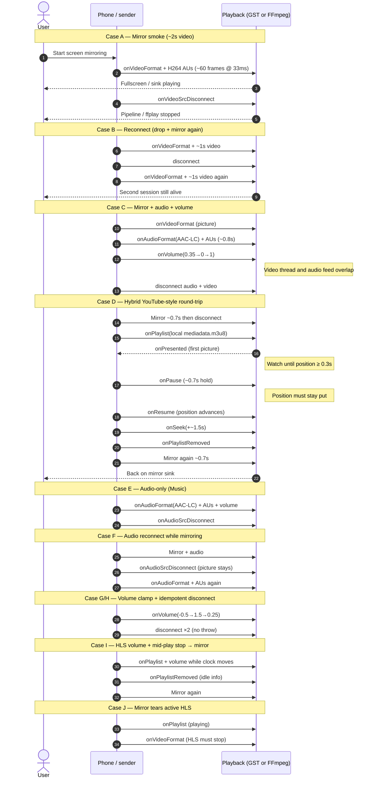

# Playback lifecycle integration tests

Shared by `app/gstreamer`, `app/ffmpeg`, and `app/mse` (`*PlaybackTest` + `PlaybackLifecycleHarness`).
Each case drives the **production** `Playback` implementation (same code as the release fat jar).

Wall-clock delays below are intentional — they mimic a user who watches for a bit,
then changes mode — not “as fast as the JVM can push buffers”.

## Timing cheat-sheet

| Step | Approx. real time | How the test does it |
|------|-------------------|----------------------|
| Mirror watch | ~2 s | 60× `onVideo` @ 33 ms |
| Short mirror burst | ~0.7–1.3 s | 20–40 frames @ 33 ms |
| AAC-LC burst | ~0.8 s | ADTS chunks @ 20 ms |
| Pause hold | ~0.7 s | `Thread.sleep` after `onPause` |
| HLS latch | up to ~20–25 s | wait for `position ≥ 0.3` |

CI-only knobs (not release `application.properties`): `airplay.*.hls.headless`,
`airplay.gst.appsink`, xvfb / Pulse null sink on the runner.
